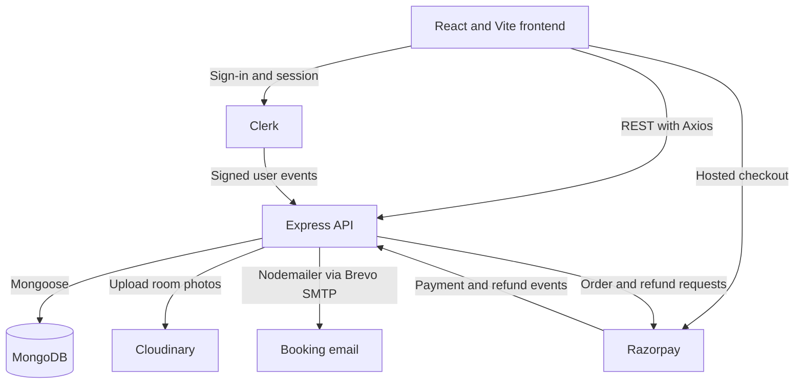

# QuickStay — Project Interview Guide

**Review basis:** Local QuickStay snapshot, 19 November 2026. Source and Vercel configs reviewed. The README describes Razorpay Test Mode. Live deployment, merchant payment-method settings, and end-to-end provider flows were unverified.

## Use this prompt in ChatGPT

> Teach me QuickStay for an SDE interview, one topic at a time. Start with the architecture and trace a guest booking through the actual APIs. Define each new term in simple language, give a small example, and name the relevant file. Ask me one main question and one follow-up, then wait. Use this guide as the source of truth. Clearly label proposed changes. Never invent deployment results, traffic, metrics, or personal contributions.

Suggested order: architecture and data → discovery and booking → Clerk and ownership → Razorpay and refunds → owner features → scaling and mock interview.

## 1. Interview pitch and resume alignment

**30-second answer.** “QuickStay is a MERN hotel-booking platform for guests and hotel owners. Guests browse and filter rooms, check their dates, book at a server-calculated price, and can pay through Razorpay from My Bookings. Owners register a hotel, add rooms with photos and amenities, control listing visibility, and view reservations. Clerk provides sign-in, Multer receives image uploads, Cloudinary hosts the photos, and Nodemailer sends booking details. My first production improvements would be atomic room reservations and reliable payment and refund reconciliation.”

| Resume point | What you can defend |
| --- | --- |
| Architected and deployed a full-stack platform with dynamic room filtering, date availability and automated pricing | React filters by city, room type and price. Express checks overlapping dates on a single room. Pricing is nightly rate × nights. Vercel configs are present. Use “deployed” when you can verify your deployment URL. |
| Integrated Razorpay with UPI, cards, NetBanking, HMAC-SHA256, asynchronous webhooks and automated refunds | The app uses Razorpay Checkout and server-created INR orders. Payment methods depend on provider configuration. Checkout verification calls HMAC-SHA256. The webhook endpoint exists, with a raw-body parsing bug. Cancellation can request a full refund, with a recovery gap if the request fails. |
| Implemented Clerk, multi-role dashboards, Cloudinary/Multer and Nodemailer | There are `user` and `hotelOwner` roles, a guest My Bookings screen and one owner dashboard. The email is sent when the reservation is created, before optional online payment. |

**Suggested resume wording**

- Built a MERN hotel-booking platform with room-type, destination and price filters, server-side date-overlap checks, and automatic booking-total calculation.
- Integrated Razorpay Checkout with server-created INR orders, HMAC-SHA256 signature verification, and cancellation-triggered refund requests.
- Implemented Clerk sign-in, guest booking management and an owner dashboard, Cloudinary uploads via Multer, and booking-detail emails via Nodemailer.

## 2. Architecture, data and access control

- **Stack.** React 19, React Router, Context, Axios, Tailwind, React Hot Toast and Vite in `client/`. One Express 5 app in `server/` with Mongoose 8, split into routes, controllers, middleware, models and configuration. The frontend and API have separate Vercel configs.
- **Routing and state.** `/` home, `/rooms` catalog, `/rooms/:id` details, `/my-bookings`, `/owner` dashboard, `/owner/add-room` and `/owner/list-room`. `/loader/:nextUrl` is a timed redirect outside the current modal payment flow. `AppContext.jsx` shares room listings, owner state, recent cities, API setup and access to Clerk tokens.
- **Authentication.** Catalog and date check are public. Protected Axios calls send a Clerk bearer token. `clerkMiddleware()` establishes auth. `protect` gets the Clerk ID, loads the MongoDB user and attaches `req.user`. If user synchronization has yet to run, `protect` can fetch the Clerk profile and provision it. No auth returns 401. Some client user-data failures retry after two seconds. Sign-in methods are configured in Clerk.
- **Clerk lifecycle.** `POST /api/clerk` verifies signed Svix headers and raw body. `user.created` and `user.updated` upsert the MongoDB profile. `user.deleted` removes the profile, with no cascade to hotels or bookings.
- **Authorization.** Hotel registration checks that the caller has no existing hotel, creates one, and updates the user to `hotelOwner`. Owner queries scope by `Hotel.owner`. Room toggle also verifies that the specific room belongs to the caller’s hotel. The client owner route guard is for navigation. Authorization resides on the server. One hotel per owner is an application rule without a unique index.

| Collection | Fields and purpose |
| --- | --- |
| User | String Clerk ID, username, email, image, role, recent searched cities. The handler keeps the last three distinct entries. |
| Hotel | String UUID, name, city, address, contact, owner reference. |
| Room | String UUID, hotel reference, room type, nightly price, amenities, image URLs, `isAvailable` listing flag. Each room document acts as one reservable listing. |
| Booking | String UUID, user/room/hotel refs, check-in/out, guests, stored total, payment method, `status`, `isPaid`, Razorpay order/payment/refund IDs. |

All four schemas have timestamps. Mongoose `populate` loads references for display. Booking stores a hotel reference for owner queries and a price snapshot so later price changes don’t alter past totals. The reviewed schemas have no custom indexes for booking history, date overlap, hotel ownership or provider IDs.

## 3. Guest, owner and email flows

**Discovery.** `GET /api/rooms` returns all publicly available listings, newest first, populates the hotel and its owner’s image, and removes entries missing a hotel. `AllRooms.jsx` filters locally by city substring, selected room types and inclusive price bands, then sorts by price or recency. The home search sends only the destination. Its dates and guest count do not affect search results. Signed-in users can save recent cities, and recommendations show up to four rooms with exact city matches. Reviews, promotional offers and the newsletter are presentation elements.

**Booking.** `RoomDetails.jsx` finds the room in Context. First submit checks dates. A subsequent submit creates the booking. Changing dates resets the availability result. The backend validates chronological dates and a positive-integer guest count, repeats the overlap query, loads the room and hotel, then calculates `pricePerNight × ceil((checkOut − checkIn) / 24h)`. Ten to thirteen July at ₹1,500 per night costs ₹4,500. The booking starts `pending`, unpaid and `Pay At Hotel`. Online payment can be chosen later in My Bookings.

**Overlap.** Model stays as `[checkIn, checkOut)`. A conflict exists when `existing.checkIn < requested.checkOut` **and** `existing.checkOut > requested.checkIn`. With a 10–13 July stay, 12–14 July overlaps and 13–15 July is allowed. The current query checks every matching booking, so cancelled bookings still block the dates. `Room.isAvailable` filters the public listing, and booking/date endpoints do not enforce it. The date check can say an unknown room ID is available if no booking matches. Creation separately checks that the room exists.

**Email.** Booking creation saves the record and then awaits a Nodemailer send through Brevo SMTP. Send failures are logged while the booking still succeeds. Email includes booking ID, hotel/address, check-in and booking amount. The template labels the total “/night” and omits checkout. This email confirms creation of the reservation. Payment confirmation is a separate concern.

**Owner workflow.** Register hotel → add a room → toggle listing visibility → inspect bookings. `AddRoom.jsx` sends multipart `FormData` with room type, price, JSON-encoded amenities and image files. UI has four image slots. Multer accepts up to five and writes to temporary disk. The controller uploads in parallel using `Promise.all` and stores Cloudinary HTTPS URLs. Dashboard shows booking counts and a booking table with pending/paid/cancelled labels. “Total Revenue” sums every booking total, including unpaid and cancelled ones. Describe it as gross booked value. Room edits, a platform-wide admin dashboard and owner revenue charts are outside current scope.

## 4. Razorpay and booking state

1. **Create order.** Pay Now in `MyBookings.jsx` calls `POST /api/razorpay/create-order`. Express verifies booking ownership and checks `isPaid`. It converts the stored booking total to paise with `Math.round(totalPrice * 100)`, creates an INR order, saves its order ID and returns checkout details and the public key ID. Repeated checkout attempts can create additional orders and overwrite the current order ID. The endpoint needs a server-side cancelled-state guard.
2. **Open checkout.** `client/index.html` loads Razorpay’s checkout script. The browser opens the modal with the order ID and amount. An order represents a payment request. A payment ID identifies an attempted/completed payment record. A refund ID identifies a refund record.
3. **Verify callback.** `POST /api/razorpay/verify-payment` computes HMAC-SHA256 of the provider order ID, a pipe character, and the payment ID with the key secret. A matching signature causes an update to `confirmed` and paid, with `paymentMethod: Razorpay`. HMAC authenticates a message with a shared secret. The current handler uses supplied order/payment values for verification and looks up the write target via the submitted booking ID. A production handler should load the user-owned booking first, verify using the stored order ID, check the linked payment’s capture status and expected amount/currency, and guard the state transition.
4. **Receive webhook.** `POST /api/razorpay/webhook` is registered before `express.json()` and receives raw JSON as a Buffer. A separate webhook secret authenticates the original body. Intended events are `order.paid`, which marks a booking confirmed by order ID, and `refund.processed`, which marks it cancelled/unpaid and stores the refund ID by payment ID. The current code parses strings only, so the Buffer has no `event` property and the handler can acknowledge without applying an update. Webhook verification also depends on having the secret configured. Require the secret, verify raw bytes, parse the Buffer, deduplicate events, and apply allowed state transitions.
5. **Cancel and refund.** `POST /api/razorpay/refund` verifies ownership and rejects previously cancelled records. Unpaid cancellations update locally. Paid bookings with a Razorpay payment ID trigger a full refund request for the stored amount. The controller stores the returned refund ID when available, marks the booking cancelled and clears `isPaid`. It can report cancellation after the refund request fails. A refund ID records the request, while completion needs its own state and reconciliation.
6. **Lifecycle.** Typical paths are `pending/unpaid → confirmed/paid → cancelled/unpaid` and `pending/unpaid → cancelled/unpaid`. Current payment writes can revive a cancelled booking. Track booking, payment and refund states independently. Cash collection at the hotel has no explicit settlement flow. `stripeWebhooks.js` is a legacy file with no mounted route or Stripe dependency in the current server manifest.

## 5. API map and implementation pointers

| Area | Actual routes | Files |
| --- | --- | --- |
| Service | `GET /` | `server/server.js` |
| Identity | `GET /api/user`, `POST /api/user/store-recent-search`, `POST /api/clerk` (provider) | `authMiddleware.js`, `userController.js`, `clerkWebhooks.js` |
| Hotel | `POST /api/hotels` | `hotelController.js`, `HotelReg.jsx` |
| Rooms | `GET /api/rooms` (public), `POST /api/rooms`, `GET /api/rooms/owner`, `POST /api/rooms/toggle-availability` | `roomController.js`, `uploadMiddleware.js`, `AllRooms.jsx`, `AddRoom.jsx`, `ListRoom.jsx` |
| Booking | `POST /api/bookings/check-availability` (public), `POST /api/bookings/book`, `GET /api/bookings/user`, `GET /api/bookings/hotel` | `bookingController.js`, `RoomDetails.jsx`, `MyBookings.jsx`, `Dashboard.jsx` |
| Payments | `POST /api/razorpay/create-order`, `POST /api/razorpay/verify-payment`, `POST /api/razorpay/refund`, `POST /api/razorpay/webhook` (provider) | `razorpayController.js`, `razorpayWebhooks.js`, `MyBookings.jsx` |

Backend files are under `server/routes/`, `server/controllers/`, `server/models/`, `server/configs/` and `server/middleware/`. Client screens are in `client/src/pages/` and `client/src/pages/hotelOwner/`.

## 6. Limitations, improvements and future scope

| Priority | Current limitation | Proposed change |
| --- | --- | --- |
| P0 Reservation integrity | Two overlapping requests can both pass the check before either inserts. Cancelled bookings keep blocking dates. | Reserve unique `(roomId, date)` inventory rows in the same transaction as the booking. Release rows on cancellation. Consider expiring online payment holds, keeping intended pay-at-hotel bookings valid. |
| P0 Payment integrity | Checkout lacks booking/order binding. Webhook parsing can skip updates. Duplicate or late events can overwrite booking state. | Bind order, user, booking and expected amount. Persist payment attempts and event IDs uniquely. Use conditional updates and reconcile missed or late events against the provider. |
| P0 Refunds and reporting | Partial failures can hide unresolved refunds. Booked value includes unpaid and cancelled reservations. UI currency can differ from INR checkout. | Track refund requested, processed and failed states. Reconcile uncertain outcomes before retrying. Report booked value, captured payments, refunds and net collections separately. Store integer minor units and explicit currency. |
| P1 Validation | Server checks are limited for listing visibility, past dates, capacity, price, payment method and upload size/type. CORS falls back to open origins when unset. | Validate server inputs, enforce room capacity and listing state, use hotel-local calendar dates, and configure upload and origin limits. |
| P1 Reliability | SMTP sits in the booking request. Temporary files and partially uploaded assets have no cleanup shown. Hotel registration and Clerk provisioning can race. | Use a retrying worker or outbox for email, clean up uploaded assets and temp files, enforce owner uniqueness, and make user upserts idempotent. Add request IDs, readiness checks and metrics for conflicts, webhook lag, refund errors and email failures. |
| P2 Search and scaling | Client receives the entire catalog. Owner dashboard loads every booking. Inventory has one document per reservable listing. | Add paginated server-side search, normalized city filters and dedicated room details endpoint. Consider compound indexes on `{user: 1, createdAt: -1}` and `{hotel: 1, createdAt: -1}` for histories. Test room/date indexing with `explain()`. Cache catalog reads if needed, with booking writes authoritative in the database. |

After correctness, product scope includes room-type stock per hotel, calendar search, editing room listings, seasonal prices, cancellation policies, owner reporting, real reviews, admin moderation, and settlement workflows. Keep the Express app as one deployable until scale or operational needs justify extracting components.

## 7. Interview cross-questions

| Question | Short answer |
| --- | --- |
| Why MERN? Could SQL work? | One language across UI and API, React for interactive screens, Express for APIs/integrations and MongoDB for the listing model. SQL could be a good fit for explicit relational constraints and financial reporting. |
| Why check availability twice? Is it sufficient? | The first check gives UI feedback. The second catches changes since that check. It leaves a concurrency gap between the query and insert. |
| Will putting the overlap query and insert in a transaction solve concurrency? | Two transactions can insert different booking documents after reading the same free interval. Make them compete for a shared resource, such as unique room-night keys. |
| Why one inventory row per night? | A unique pair of start/end dates only blocks identical stays. Room-night keys make overlapping stays conflict on the shared nights. Exclude the checkout day and commit all reserved nights together. |
| Can the browser set the final price? | No. The backend derives the total from the stored room price, and the Razorpay order uses the booking’s stored total. Demand-based or seasonal pricing would be a future feature. |
| What if the tab closes after paying? | The browser callback may never reach Express. A working webhook and a reconciliation process allow the backend to update independently. The Buffer parsing fix is needed here. |
| Why two HMAC signatures? | Checkout uses order/payment identifiers and the key secret. The webhook uses the original event payload and its own webhook secret. Each authenticates a different message. |
| Why use the stored order ID? | A valid signature authenticates the provider pair. The stored order is the connection to the customer’s booking. Verify ownership, amount and state before confirming anything. |
| What if an event comes twice or arrives late? | Current writes lack deduplication and state guards. Store event IDs uniquely, use conditional state transitions, and reconcile with provider status so repeats are harmless. |
| How is cancellation different from a refund? | Cancellation releases a reservation. A refund moves money and can succeed or fail later. Track the two outcomes independently. |
| Can one owner access another hotel’s bookings? | The server derives the owner from Clerk and resolves their hotel before querying its bookings. The room toggle also checks resource ownership. |
| Why both Multer and Cloudinary? | Multer receives multipart files on the API. Cloudinary hosts them. MongoDB stores URLs and room metadata. |
| Is dashboard revenue money received? | Current gross booked value includes unpaid and cancelled reservations. Report captured, refunded, net, and cash amounts separately in production. |
| What’s tricky about date math? | Hotels follow local calendar nights. Counting elapsed hours can produce wrong nights when timestamps, time zones or daylight-saving transitions are allowed. |
| What did you personally build? | Choose code paths you worked on. Explain a real decision, point to a file or test, and describe the actual result or limitation. Use a deployment URL only after verifying it. |

## 8. Setup, demo and verification

- **Local setup.** Use each folder’s `.env.example` for configuration names. Run `npm ci` in both folders, then `npm start` in `server/` and `npm run dev` in `client/`. Client needs backend URL and Clerk publishable key. Server integrates MongoDB, Clerk, Razorpay, Cloudinary and Brevo SMTP. `FRONTEND_URL` controls CORS and `VITE_CURRENCY` controls much of the UI. The API exports the app for Vercel and listens locally otherwise. `GET /` checks the Express response only. `seed.js` replaces data across all four collections. Use a disposable database for seeded data.
- **Demo path.** Browse/filter → show a date conflict and an adjacent stay → create a reservation → review My Bookings → try Razorpay Test Mode and cancellation → sign in with a separate owner account → upload a room photo → toggle listing visibility → inspect owner bookings.
- **Tests to add.** Adjacent and overlapping dates, cancelled booking availability, simultaneous bookings, customer and owner isolation, wrong checkout order/booking, raw signed and duplicate webhooks, late payment after cancellation, refund failure/retry, email failure after saving, and partial image upload errors.
- **Verification performed.** Reviewed frontend and backend source, manifests, deployment configs and seed. All server JavaScript passed `node --check`. A local Node check confirmed that accessing `event` on a Buffer returns undefined until it is parsed. No automated project test suite was found. Database-backed and external integration flows were unverified.

Provider references: [Razorpay Checkout integration](https://razorpay.com/docs/payments/payment-gateway/web-integration/standard/integration-steps) and [Razorpay webhook validation and testing](https://razorpay.com/docs/webhooks/validate-test).
